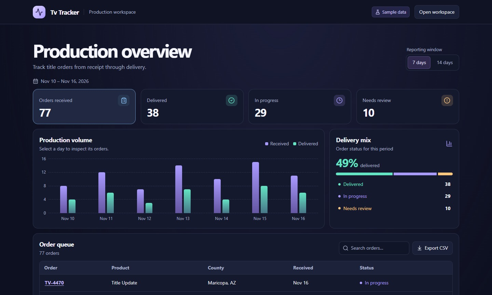

# Tv Tracker

Tv Tracker is a Windows workspace for title-production operations. Capture a TitleVision queue, review SLA and production reports, compare saved captures, and export Excel files for reporting.

[Windows x64 release](https://github.com/mayanknandgowle/Tv_Tracker/releases/latest) · [Handover and build guide](docs/HANDOVER.md) · [Architecture](PROJECT_ARCHITECTURE.md)



## Explore the sample workspace

Open **Sample workspace** in the app sidebar. The demo contains 123 synthetic orders and runs without a Google account, portal login, or backend. Switch the reporting window, select a chart day or status, search by order number, open an order, or export the filtered queue as CSV.

To open the demo in a browser from this checkout, use Node.js 22.12+ and run:

```powershell
npm.cmd --prefix gsheet_dashboard/frontend ci
npm.cmd --prefix gsheet_dashboard/frontend run dev
```

Open [the local demo](http://127.0.0.1:5173/demo.html). The command prints the host and port if 5173 is in use.

## Run the Windows app

1. Download the installer or portable ZIP from the [latest release](https://github.com/mayanknandgowle/Tv_Tracker/releases/latest). For the portable ZIP, extract the entire archive and open **Tv Tracker Workspace.exe**.
2. Select **Sample workspace** to explore. For live work, open **Connections & settings** and enter your spreadsheet, service account, and TitleVision connection.
3. Use **Captures** for raw snapshots, **Changes** to compare them, and the reporting views to review SLA, daily and monthly orders, and capacity.

**v1.0.0** starts this repository's version history. It comes from [upstream tv-tracker-app v1.0.23](https://github.com/HariKrishna1-DS/Tv-Tracker/releases/tag/v1.0.23) at commit `2a5d0022e9b28ce2193350ea25ba3379a3d3c16c`. This repository credits the upstream authors and publishes the desktop application on `main`. Archived upstream notes under `docs/` describe the original project.
